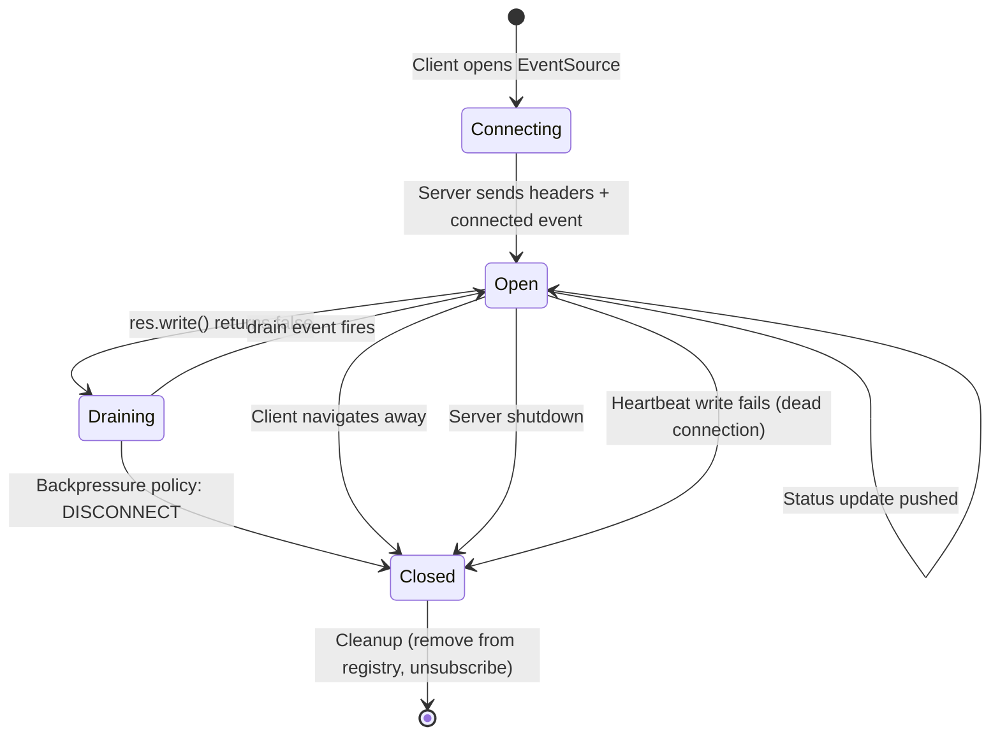

# Phase 5 — Realtime SSE + Backpressure

> **Architecture Decision Record**
> This document explains WHY Phase 5 exists, what architectural changes were made, and the tradeoffs introduced.

---

## The Problem We're Solving

In Phase 4, the only way for a client to know an order's status is **polling**:

```
Client: GET /orders/123   → PENDING    (wasted request)
Client: GET /orders/123   → PENDING    (wasted request)
Client: GET /orders/123   → CONFIRMED  (useful!)
Client: GET /orders/123   → CONFIRMED  (wasted request)
Client: GET /orders/123   → CONFIRMED  (wasted request)
Client: GET /orders/123   → PREPARING  (useful!)
... repeat for 20+ minutes until DELIVERED ...
```

**Impact at scale:**

| Active Customers | Poll Interval | Queries/Minute | Status Changes/Order |
|---|---|---|---|
| 100 | 5 seconds | 1,200 | ~6 |
| 1,000 | 5 seconds | 12,000 | ~6 |
| 10,000 | 5 seconds | 120,000 | ~6 |

With 10,000 customers tracking orders, we'd see **120,000 queries/minute** for data that changes only ~6 times per order lifecycle. Over 99% of polls return unchanged data.

**SSE eliminates this entirely.** Zero wasted requests. Sub-100ms update latency. One DB write triggers one push to exactly the right client(s).

---

## Architecture Evolution

```
Phase 4:
  Client ──poll──> API ──> PostgreSQL
                    ↓
                  Cache (Redis)

Phase 5:
  Client ──SSE──> API ──> SSEManager ──heartbeat──> Client
                    ↑
              Redis Pub/Sub  ◄──── subscribe
                    ↑
              Redis PUBLISH  ◄──── Notification Consumer ◄──── Kafka
```

### The Cross-Instance Fanout Problem

When a notification consumer processes an `ORDER_STATUS_CHANGED` event from Kafka, it needs to push an update to the client watching that order. But **which API instance** holds the client's SSE connection?

```
API Instance 1: holds SSE for orders A, C, E
API Instance 2: holds SSE for orders B, D, F

Consumer processes status change for order B
  → Which instance has order B's SSE connection?
  → Consumer doesn't know. Can't push directly.
```

**Solution: Redis Pub/Sub as a broadcast bus.**

1. Consumer publishes `{status: "CONFIRMED"}` to Redis channel `op:sse:order:B`
2. ALL API instances subscribe to channels for their active orders
3. Instance 2 receives the message, finds order B's SSE connection, pushes to client
4. Instance 1 also receives it, has no listeners for order B, ignores it

This is the **pub/sub fanout pattern** — the same pattern used by Slack, Discord, and every chat system.

---

## Why SSE Over WebSockets

| Factor | SSE | WebSocket |
|---|---|---|
| **Direction** | Server → Client (unidirectional) | Bidirectional |
| **Protocol** | Plain HTTP/1.1 | Upgraded protocol (ws://) |
| **Auto-reconnect** | Built-in (`Last-Event-ID`) | Must implement yourself |
| **Proxy compatibility** | Works through any HTTP proxy | Requires ws-aware proxy |
| **Load balancer** | Standard HTTP load balancing | Needs sticky sessions |
| **Complexity** | Simple text stream | Binary framing, ping/pong |

**For order tracking, SSE is optimal because:**

1. **Unidirectional** — server pushes status, client just listens
2. **Automatic reconnection** — `EventSource` API resumes from `Last-Event-ID`
3. **Proxy-safe** — works through Nginx, AWS ALB, Cloudflare without configuration
4. **No sticky sessions** — any API instance can serve the reconnection

**When would we switch to WebSockets?**
- Client needs to send messages to the server (live chat, collaborative editing)
- Binary data streaming (audio/video)
- Sub-10ms latency requirements (gaming)

---

## Redis Pub/Sub vs Redis Streams vs Kafka

| Feature | Pub/Sub | Redis Streams | Kafka |
|---|---|---|---|
| **Persistence** | None | Yes (in Redis memory) | Yes (on disk) |
| **Consumer groups** | No | Yes | Yes |
| **Replay** | No | Yes (by ID) | Yes (by offset) |
| **Latency** | Sub-millisecond | Sub-millisecond | 1-10ms |
| **Throughput** | ~1M msg/s | ~500K msg/s | ~1M msg/s |
| **Use case** | Fanout/notify | Task queues | Event sourcing |

**We chose Pub/Sub because:**

1. **No persistence needed** — events are already persisted in Kafka (the source of truth)
2. **Fire-and-forget is fine** — if nobody is listening, the message is lost, but Kafka still has it
3. **Lowest latency** — sub-millisecond delivery for realtime UX
4. **Simplest semantics** — no consumer groups, offsets, or acknowledgments to manage

---

## Backpressure — The Silent Production Killer

### What Is Backpressure?

When a server writes data faster than a client can read it:

```
Server: writes 1MB/s to SSE connection
Client: reads 100KB/s (slow 3G mobile connection)
→ 900KB/s accumulates in the server's memory
→ After 10 minutes: 540MB of buffered data for ONE client
→ Container OOM-killed → ALL connections drop
```

### How Node.js Handles It

```javascript
const accepted = res.write(data);
// accepted = true  → kernel accepted the data
// accepted = false → kernel buffer full, Node.js is buffering in userspace
//                    STOP WRITING until 'drain' event fires!
```

**Most tutorials ignore the return value of `res.write()`.** This is safe for small responses but fatal for long-lived streams.

### Our Backpressure Strategy

```
Buffer < 64KB:   ACCEPT (normal operation)
Buffer 64-256KB: ACCEPT + WARNING log (client is falling behind)
Buffer > 256KB:  APPLY POLICY (protect the server)
```

**Policy options:**
- `DROP_NEWEST` (our default): Skip this event, keep existing buffer
- `DROP_OLDEST`: Replace oldest buffered event with new one
- `DISCONNECT`: Close the slow client's connection entirely

### Real-World Backpressure Failures

1. **Slack (2020)**: Message fanout to slow clients caused memory exhaustion
2. **Twitter**: Streaming API disconnects slow consumers after buffer fills
3. **Every SSE/WebSocket server ever**: If you don't handle backpressure, your server will eventually OOM

---

## Connection Lifecycle



### Heartbeat: Why 15 Seconds?

Heartbeats solve three problems:

1. **Proxy timeout prevention**: AWS ALB (60s), Nginx (60s), Cloudflare (100s) all close idle connections. Our 15s heartbeat keeps connections alive.

2. **Dead connection detection**: If a mobile client enters a tunnel, TCP doesn't notice immediately. Heartbeat writes eventually trigger EPIPE, letting us detect and clean up.

3. **Client reconnection trigger**: The `EventSource` API reconnects when it detects the connection is closed. Regular heartbeats help distinguish "server is quiet" from "connection is dead".

---

## New Components

### SSE Module (`src/sse/`)

| File | Responsibility |
|---|---|
| `types.ts` | SSE event types, connection states, backpressure config, metrics |
| `sse-connection.ts` | Individual SSE connection wrapper (protocol formatting, heartbeat, backpressure tracking) |
| `sse-backpressure.ts` | Per-connection buffer tracking, threshold detection, policy enforcement |
| `sse-manager.ts` | Connection registry (orderId → connections), fanout broadcast, metrics, graceful shutdown |
| `redis-subscriber.ts` | Dedicated Redis connection for SUBSCRIBE, channel management, reconnection |
| `sse-routes.ts` | HTTP endpoint (`GET /orders/:id/stream`), Fastify reply.hijack(), initial state delivery |
| `index.ts` | Barrel export |

### Data Flow

```
1. Client → GET /api/v1/orders/123/stream
2. Server validates order exists
3. Server calls reply.hijack() (takes control of response)
4. SSEManager.addConnection(res, orderId) → SSEConnection created
5. SSEManager → SSERedisSubscriber.subscribe("op:sse:order:123")
6. SSE response: initial_state event with current order data
7. Heartbeat timer starts (every 15s)

--- later, order status changes ---

8. Notification consumer processes ORDER_STATUS_CHANGED from Kafka
9. Consumer calls Redis.PUBLISH("op:sse:order:123", statusData)
10. SSERedisSubscriber receives message on channel
11. SSERedisSubscriber → SSEManager.broadcastToOrder("123", event)
12. SSEManager → SSEConnection.send(event)
13. Client receives: event: status_update, data: {"status":"CONFIRMED"}

--- when client disconnects ---

14. Response 'close' event fires
15. SSEConnection.close() → stops heartbeat
16. SSEManager removes connection from registry
17. If last listener → SSERedisSubscriber.unsubscribe("op:sse:order:123")
```

---

## Failure Modes

### 1. Redis Pub/Sub Connection Drops

**Symptom**: SSE connections stay open but stop receiving updates.
**Detection**: Health check shows `redis.status: down`.
**Recovery**: `ioredis` auto-reconnects. `SSERedisSubscriber.on('ready')` re-subscribes to all active channels.
**Client impact**: Temporary gap in updates. Client can poll GET /orders/:id as fallback.

### 2. API Instance Crashes

**Symptom**: All SSE connections on that instance drop simultaneously.
**Detection**: Client's `EventSource` fires `error` event.
**Recovery**: `EventSource` auto-reconnects (3s delay). Load balancer routes to another instance. New instance sends initial_state with current order data.
**Data loss**: None — events are in Kafka. Client might miss intermediate status updates but gets current state on reconnect.

### 3. Slow Client (Backpressure)

**Symptom**: `res.write()` returns `false`. Buffer grows.
**Detection**: Backpressure warning logs. Health check shows `backpressureEventsTotal` increasing.
**Recovery**: At 256KB buffer, DROP_NEWEST policy skips new events. Client catches up, `drain` event fires, normal operation resumes.
**Client impact**: May miss some intermediate events but gets the next one after catching up.

### 4. Connection Limit Exhaustion

**Symptom**: New SSE requests get 503 Service Unavailable.
**Detection**: Health check shows `activeConnections` at max.
**Recovery**: Scale up API instances. Old connections eventually close (order delivered/cancelled).
**Operational action**: Alert on `activeConnections > 80% of max`.

### 5. Kafka Consumer Lag

**Symptom**: Status updates appear delayed in SSE.
**Detection**: Kafka UI shows growing consumer lag.
**Recovery**: Consumer catches up automatically. Consider adding more consumer instances.
**Client impact**: Updates arrive late but in correct order (per partition).

---

## Shutdown Sequence

```
1. SSEManager.shutdown()
   → Send 'event: shutdown' to ALL connected clients
   → Close all connections (clean TCP FIN)
   → Clients see shutdown event, show "reconnecting..." UI
   → EventSource auto-reconnects to another instance

2. HTTP server.close()
   → Stop accepting new connections
   → Drain in-flight requests

3. LeaderElection.stop()
   → Release leadership lease
   → Another instance takes over outbox relay

4. OutboxRelay.stop()
   → Stop polling, flush in-progress batch

5. Kafka producer.disconnect()
   → Flush pending messages

6. SSERedisSubscriber.disconnect()
   → Unsubscribe all channels
   → Close dedicated Redis connection

7. Redis (main).disconnect()
   → Close main Redis connection

8. DB pool.end()
   → Close all PostgreSQL connections
```

**Key insight**: SSE drains BEFORE HTTP closes. If we closed HTTP first, all SSE connections would get an abrupt TCP RST with no explanation. By draining first, clients get a clean shutdown event.

---

## Scaling Considerations

### Current Limits (Single Instance)

- **Max SSE connections**: 1,000 (configurable)
- **Memory per connection**: ~5KB
- **Max SSE memory**: ~5MB for 1,000 connections
- **File descriptors**: 1,000 (check `ulimit -n`)
- **Heartbeat CPU**: Negligible (one timer write per 15s per connection)

### When to Scale

| Signal | Action |
|---|---|
| `activeConnections > 800` | Add API instance |
| `backpressureEventsTotal` increasing | Investigate slow clients, consider longer heartbeat |
| `eventsDroppedTotal` increasing | Review backpressure policy, consider DISCONNECT for extreme cases |
| Redis Pub/Sub latency > 10ms | Consider Redis Cluster or dedicated Pub/Sub instance |

### Horizontal Scaling Pattern

With N API instances behind a load balancer:
- Each instance subscribes to Redis Pub/Sub for its active orders
- Redis Pub/Sub broadcasts to ALL subscribers
- Only the instance with the matching SSE connection delivers the event
- No sticky sessions needed for SSE (unlike WebSockets)
- Reconnections go to any instance (initial_state ensures consistency)

---

## What's Next (Phase 6)

Phase 6 adds **Observability** (Prometheus + Grafana), which will let us:
- Dashboard the SSE metrics we exposed in this phase
- Alert on backpressure events, connection saturation, and Redis Pub/Sub lag
- Trace the full event lifecycle: Outbox → Kafka → Consumer → Redis → SSE → Client
- Measure end-to-end latency from order status change to client notification
